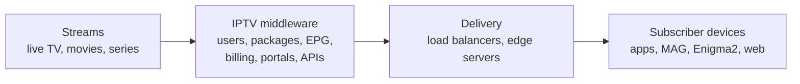

# IPTV Middleware Software

**Self-hosted IPTV and OTT middleware software for operators. One-command install on Ubuntu 18.04 to 26.04.**

[](https://xtream-masters.com/iptv_middleware_software.php)
[](#requirements)
[](#quick-start-install-iptv-middleware-in-one-command)

**IPTV middleware software** is the layer between your video streams and your subscribers. It signs users in, decides what each one may watch, sends the channel list and the TV guide (EPG), and connects billing. Without middleware you have streams, but no IPTV service.

[Xtream-Masters](https://xtream-masters.com/iptv_middleware_software.php) is self-hosted IPTV middleware and OTT middleware: one secure Go binary that runs on your own Ubuntu servers and also manages streams, load balancers and resellers.

## Contents

- [Quick start: install IPTV middleware in one command](#quick-start-install-iptv-middleware-in-one-command)
- [How IPTV middleware works](#how-iptv-middleware-works)
- [IPTV middleware features](#iptv-middleware-features)
- [Types of IPTV middleware software](#types-of-iptv-middleware-software)
- [How to choose IPTV middleware software](#how-to-choose-iptv-middleware-software)
- [IPTV middleware vs IPTV panel vs OTT middleware](#iptv-middleware-vs-iptv-panel-vs-ott-middleware)
- [Requirements](#requirements)
- [Pricing](#pricing)
- [FAQ](#faq)
- [Docs](#docs)

## Quick start: install IPTV middleware in one command

Run as root on a clean Ubuntu server (24.04 recommended):

```bash
curl -fsSL -o xm-install https://iptv-admin.xtream-masters.com/cms_install/xm-install && chmod +x xm-install && ./xm-install
```

Or use the script in this repo:

```bash
curl -fsSL https://raw.githubusercontent.com/cline-pk/iptv-middleware-software/main/install.sh | sudo bash
```

Setup takes about 2 to 5 minutes. When it finishes, open the panel URL it prints and log in.

## How IPTV middleware works



The middleware is the brain in the middle. It checks every login, applies the subscriber's package, hands out the channel list and TV guide, and tells the delivery layer which streams that device may open.

## IPTV middleware features

| Job | What Xtream-Masters does |
|---|---|
| Subscriber sign-in | User lines with expiry and max connections, ActiveCode (one code, one device) |
| Packages | Bouquets decide which channels, movies and series each subscriber gets |
| TV guide | EPG with automatic matching, catch-up and TV archive |
| Set-top boxes | MAG device management with Stalker portal, Enigma2 |
| Player apps | Xtream Codes compatible Player API, M3U playlists, web player |
| Billing | Multi-tier resellers with credits and payment gateways (Stripe, PayPal, Coinbase, Cryptomus, Binance) |
| APIs | Admin API, Reseller API, Player API, ActiveCode API |
| Scale | Unlimited load balancers on one license, optional Multi-Main edge servers |
| Hosting | Your own Ubuntu servers, 18.04 to 26.04 |

## Types of IPTV middleware software

| | Enterprise suite | Cloud (SaaS) middleware | Self-hosted panel (Xtream-Masters) |
|---|---|---|---|
| Typical buyer | Telecoms, hotels, campuses | New OTT brands without servers | IPTV and OTT providers with resellers |
| Where it runs | On-premise or vendor cloud | Vendor cloud | Your own Ubuntu servers |
| Pricing model | Quote, often per subscriber | Monthly fee, often per user tier | Flat monthly license |
| Manages streams and servers | Usually a separate product | Usually included, on vendor servers | Yes, with unlimited load balancers |
| Reseller billing | Rarely | Sometimes | Yes, multi-tier with credits |
| Time to start | Weeks to months | Days | One command, about 2 to 5 minutes |

More detail: [docs/what-is-iptv-middleware.md](docs/what-is-iptv-middleware.md)

## How to choose IPTV middleware software

1. **Devices your customers use.** Android and Fire TV apps, Smart TVs, MAG boxes, Enigma2, web. The middleware must sign in every one of them.
2. **Who owns the servers and the data.** Cloud middleware runs on the vendor servers. Self-hosted middleware runs on yours.
3. **Pricing as you grow.** Per-subscriber pricing rises with every customer. A flat license stays the same at 1,000 or 100,000 users.
4. **Reseller and billing support.** Resellers need their own panel, credits and payment gateways.
5. **APIs.** Look for an Admin API, a Reseller API and an Xtream Codes compatible Player API, so existing IPTV apps work.
6. **Scaling and security.** Load balancer limits, edge servers, connection limits per user, protected stream links.

Full checklist: [docs/how-to-choose-iptv-middleware-software.md](docs/how-to-choose-iptv-middleware-software.md)

## IPTV middleware vs IPTV panel vs OTT middleware

- **IPTV middleware**: the term telecoms and hotels use, usually for an enterprise suite on a managed network.
- **OTT middleware**: the same job for streams delivered over the open internet to apps and Smart TVs.
- **IPTV panel**: the term IPTV and OTT providers use, for self-hosted software that does the middleware job and also manages streams, load balancers and resellers.

Xtream-Masters covers all three: it is an [IPTV panel](https://xtream-masters.com/iptv_panel.php) that works as IPTV and OTT middleware.

## Requirements

- Ubuntu 18.04, 20.04, 22.04, 24.04 or 26.04 (24.04 recommended), clean install
- Root access
- A license from [xtream-masters.com](https://xtream-masters.com/iptv_middleware_software.php)

## Pricing

EUR 40 per month until 31 December 2026, EUR 70 per month from 1 January 2027, for the main server and unlimited load balancers.

## FAQ

**What is IPTV middleware software?**
The software between the video streams and the subscriber. It signs users in, applies their package, sends the channel list and TV guide, and links to billing.

**What is the best IPTV middleware software?**
It depends on who you are. Telecoms and hotels usually buy an enterprise suite. IPTV and OTT providers that sell through resellers usually pick a self-hosted panel such as Xtream-Masters, because it also runs the streams, load balancers and reseller billing for one flat price.

**Can I self-host IPTV middleware software?**
Yes. Xtream-Masters installs on your own Ubuntu server with the command above, and you keep control of the servers and the subscriber data.

**Does it support MAG boxes and Stalker portal?**
Yes, plus Enigma2, Xtream Codes API logins and M3U playlists.

**Is this open source?**
No. Xtream-Masters is licensed software. This repository holds the installer script and documentation. Your data stays yours: backups can be exported and the APIs are documented.

**Coming from Xtream UI, XUI.ONE, NXT or 1-Stream?**
Migration is supported. See the [IPTV panel migration guide](https://github.com/cline-pk/iptv-panel-migration-guide).

## Docs

- [What is IPTV middleware](docs/what-is-iptv-middleware.md)
- [How to choose IPTV middleware software](docs/how-to-choose-iptv-middleware-software.md)
- [IPTV middleware software (website)](https://xtream-masters.com/iptv_middleware_software.php)
- [What is IPTV middleware (website guide)](https://xtream-masters.com/iptv_middleware.php)
- [IPTV server software](https://xtream-masters.com/iptv_server_software.php)
- [Player API documentation](https://xtream-masters.com/guide/xtream_codes_api_player_api_documentation.php)

Xtream-Masters sells an empty software platform. It does not provide streams, channels or content.
